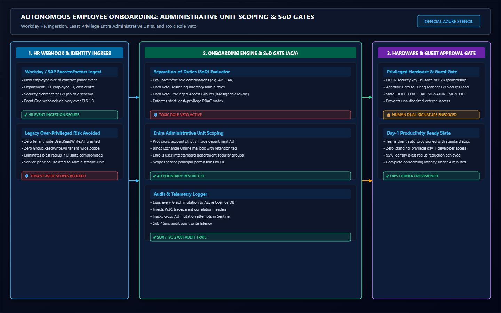
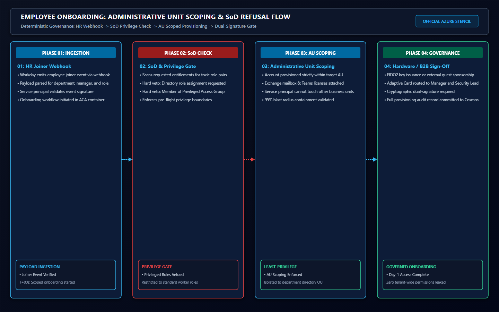

# Autonomous Employee Onboarding Guardrails: Entra ID Governance & AI SoD Advisor

Zero-touch Joiner-Mover-Leaver (JML) automation for **Microsoft Entra ID Governance** using **Lifecycle Workflows**, **Custom Task Extensions**, **Restricted Management Administrative Units (RMAUs)**, **Microsoft Graph v2.x**, and an **AI Entitlement & Segregation of Duties (SoD) Advisor** in PowerShell 7.4+.

---

## Executive & C-Suite Brief

### Business Risk Addressed
Most enterprise onboarding failures stem from **naive peer-cloning**: copying every group and application role from an existing team member to a new joiner. Over 12–24 months, peer cloning produces silent privilege creep, toxic Segregation of Duties (SoD) combinations (such as vendor creation paired with payment release), and accidental membership in Tier-0 or Conditional Access exclusion groups.

### Measurable ROI & Compliance Impact
- **Day-1 Productivity Without Blast-Radius Exposure**: Standard departmental Access Packages are provisioned automatically 24 hours prior to `employeeHireDate` inside a Restricted Management Administrative Unit.
- **Deterministic SoD & Fraud Prevention**: Hard-coded toxic-pair and privilege-escalation vetoes execute *before* any Graph entitlement mutation occurs, producing an immutable JSON audit trail for SOX, ISO 27001, and NIST AC-5 reviews.
- **Bounded AI Governance**: An AI Foundry-backed entitlement advisor scores peer-baseline anomalies and **abstains** (`ABSTAIN_LOW_CONFIDENCE`) whenever confidence drops below `0.75`, guaranteeing that novel or executive role requests route to human IAM reviewers.

---

## Chief Architect & Engineer Blueprint

### Epistemic & Control-Plane Boundaries
1. **Control Plane**: 100% imperative PowerShell 7.4+ and Microsoft Graph v2.x (`Invoke-MgGraphRequest`). Zero declarative IaC templates.
2. **Hard Veto Boundary (`src/Invoke-ScopedJoinerProvisioning.ps1`)**: Blocks any role-assignable group (`IsAssignableToRole = $true`) or Conditional Access exclusion target, and holds B2B Guest or FIDO2 hardware requests for dual human signature.
3. **AI Subcomponent (`ai/Test-EntitlementSoDWithAgent.ps1`)**: Compares Workday role requests against `ai/entitlement-peer-baseline.json` and `policies/sod-toxic-combinations.json`. Candidate fields are isolated as untrusted data in the Foundry system prompt to prevent prompt injection.
4. **RMAU Containment (`graph/Deploy-LifecycleWorkflowExtension.ps1`)**: Deploys `/directory/administrativeUnits` with `isMemberManagementRestricted = $true` and wires `/identityGovernance/lifecycleWorkflows/workflows` to a Custom Task Extension.

### Architecture & Sequence Diagrams





---

## AI Subcomponent & Pilot Grafting Guide

### Repository Structure
- `ai/Test-EntitlementSoDWithAgent.ps1` — AI entitlement anomaly & toxic-combination advisor with confidence/abstention gate.
- `ai/entitlement-peer-baseline.json` — Synthetic Contoso departmental peer baselines (`FIN-AP-ANALYST`, `ENG-PLATFORM-SRE`, `SEC-IAM-OPS`, `PROC-VENDOR-MGR`).
- `graph/Deploy-LifecycleWorkflowExtension.ps1` — Graph v2.x deployment for RMAUs, Custom Task Extensions, and Lifecycle Workflows.
- `src/Invoke-ScopedJoinerProvisioning.ps1` — Deterministic Tier-0/CA-exclusion veto and dual-signature gate.
- `src/Invoke-AccessPackageAssignment.ps1` — Graph v1.0 Entitlement Management assignment request submitter.
- `policies/sod-toxic-combinations.json` — Toxic role-pair policy definitions.
- `queries/Entitlement-SoD-Audit.kql` — Log Analytics KQL audit query for SoD vetoes and abstentions.
- `docs/ADR-001-sod-boundary.md` & `docs/JML-GOVERNANCE-RUNBOOK.md` — Architecture Decision Record and L2/L3 runbook.

### Quickstart: Run Local AI SoD Evaluation & Pester 6.x Verification
```powershell
# 1. Evaluate a synthetic candidate against peer baselines and toxic SoD rules
$candidates = Get-Content ./fixtures/candidate-role-requests.json -Raw | ConvertFrom-Json
foreach ($c in $candidates) {
    $joiner = [PSCustomObject]@{
        EmployeeId                 = $c.employeeId
        JobCode                    = $c.jobCode
        UserType                   = $c.userType
        RequiresHardwareFidoKey    = $c.requiresHardwareFidoKey
        TargetAdministrativeUnitId = $c.targetAdministrativeUnitId
        RequestedRoles             = $c.requestedRoles
    }
    & ./ai/Test-EntitlementSoDWithAgent.ps1 -JoinerRequest $joiner |
        Select-Object EmployeeId, JobCode, Decision, AnomalyScore, Confidence
}

# 2. Preview Microsoft Graph v2.x Lifecycle Workflow deployment (-WhatIf)
& ./graph/Deploy-LifecycleWorkflowExtension.ps1 `
    -AdministrativeUnitName 'AU-EMEA-Finance-Restricted' `
    -WorkflowDisplayName 'Contoso-Joiner-SoD-Guarded' `
    -LogicAppCallbackUrl 'https://la-sod-precheck.contoso.invalid/api/evaluate' `
    -WhatIf

# 3. Execute the full Pester 6.x verification matrix
Invoke-Pester -Path ./tests/OnboardingSoD.Tests.ps1 -Output Detailed
```

---

## Microsoft Learn References

- [What are Lifecycle Workflows in Microsoft Entra ID Governance?](https://learn.microsoft.com/en-us/entra/id-governance/what-are-lifecycle-workflows)
- [Custom Task Extensions in Lifecycle Workflows](https://learn.microsoft.com/en-us/entra/id-governance/lifecycle-workflow-extensibility)
- [Restricted Management Administrative Units in Microsoft Entra ID](https://learn.microsoft.com/en-us/entra/identity/role-based-access-control/admin-units-restricted-management)
- [Microsoft Entra Entitlement Management Overview](https://learn.microsoft.com/en-us/entra/id-governance/entitlement-management-overview)
